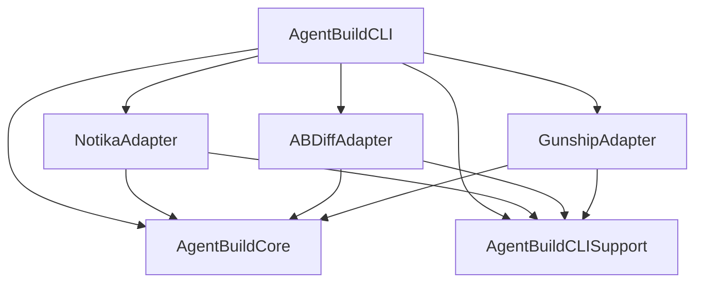

# Module ownership

The root `Package.swift` builds one `agentbuild` executable from shared targets
and three project adapter targets. Each adapter owns its commands, project
planning, workflow policy, reports, and tests under `Adapters/<project>`.
There are no runtime adapter discovery or dynamic-library installation steps.
SwiftPM compiles the target dependencies into the executable; changing an
adapter requires rebuilding `agentbuild`.

| Target | Sources | Tests |
| --- | --- | --- |
| `AgentBuildCore` | `Sources/AgentBuildCore` | `Tests/AgentBuildCoreTests` |
| `AgentBuildCLISupport` | `Sources/AgentBuildCLISupport` | Exercised through CLI integration tests |
| `NotikaAdapter` | `Adapters/Notika/Sources` | `Adapters/Notika/Tests` |
| `ABDiffAdapter` | `Adapters/ABDiff/Sources` | `Adapters/ABDiff/Tests` |
| `GunshipAdapter` | `Adapters/Gunship/Sources` | `Adapters/Gunship/Tests` |
| `AgentBuildCLI` | `Sources/AgentBuildCLI` | CLI integration tests in the owning target |

The CLI registers each adapter's command type explicitly. It also registers
the generic native helper and Notika's private documentation-preview command
so self-reexecution continues to enter the same executable.

An adapter must not import another adapter. The shared core and CLI support
must not depend on any adapter. These boundaries are enforced by the target
dependency graph. Keep shared implementation APIs `package` where only sibling
targets need them; exported library APIs and their required types remain
`public`. Do not make all implementation details public to move files.

# Shared responsibilities

`AgentBuildCore` owns compilation admission, native supervision and worker
protocols, raw-log custody, retained artifacts, canonical and strict JSON,
repository observations, and generic Xcode phase splitting. Shared types use
neutral names such as `NativeObservation`, `ControllerSessionArtifacts`,
`RepositorySourceSnapshot`, `ResultBundleTree`, and `ExecutedTests`.

The shared inherited-environment allowlist is `ChildEnvironmentPolicy`.
Notika's native cache bindings and `NOTIKA_DERIVED_DATA` policy stay in
`NotikaAdapter`. ABDiff's source-snapshot wrapper supplies its generated graph
inputs and translates shared failures to ABDiff's established errors; the shared
snapshot has no implicit project files. Notika's xcresult custody and performance
acceptance rules stay in its adapter, while bounded result-tree retention and
xcresult count parsing are shared.

`AgentBuildCLISupport` owns the signal relay and current-executable resolution.
Adapters use it without depending on the CLI executable target. Only the
executable target has an `@main` entry point.

Swift library consumers import the adapter module for project-specific types;
`import AgentBuildCore` provides shared execution APIs. CLI command names,
retained JSON schemas, resource namespaces, and worker protocol commitments
remain independent of Swift source-directory and module names.

# Tests and development

Use `make build` and `make test` so compilation holds the account-wide gate.
Tests compile under that gate and execute after its release. To run one adapter's
tests, use `make test TEST_FILTER=GunshipAdapterTests` (or `ABDiffAdapterTests` or
`NotikaAdapterTests`). Existing suite-name filters also work.

`AgentBuildTestSupport` supplies a common package-root location for fixtures and
the built CLI. Test targets depend on their own adapter, shared core, and test
support. Retained Notika performance fixtures remain under `Tests/Evidence`.
Controller fixtures do not establish that a real project build or UI workflow
has passed; record native verification separately in its workflow document.

To add an adapter, create its `Sources` and `Tests` directories, declare the two
targets with only shared dependencies, and register its root command in
`AgentBuildCommand`. Add its workflow contract and index entry. A separate
`Package.swift` is unnecessary unless the adapter needs an independent package
lifecycle.
